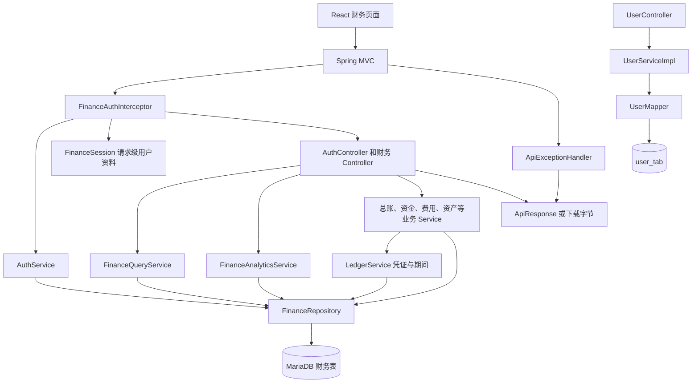
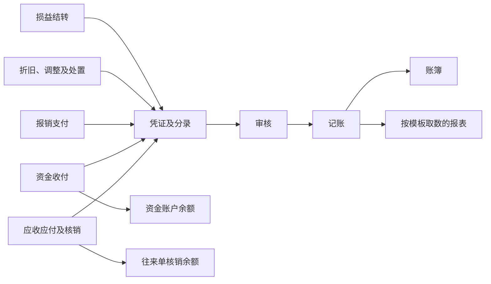
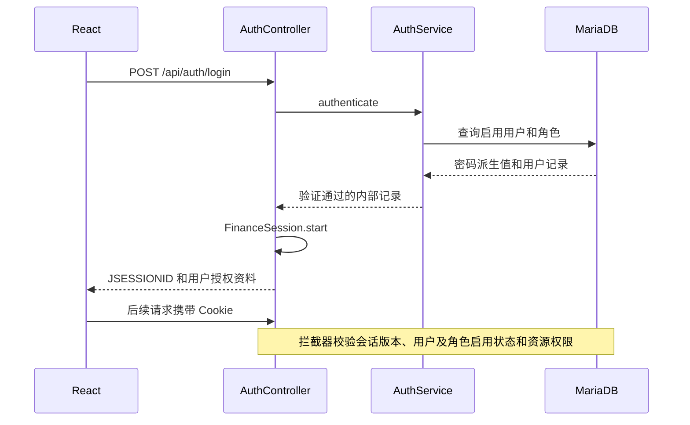

# ERP 服务端架构

本项目采用 Spring Boot 4.1.2、Java 17 和 MariaDB，以单个应用提供财务 API。财务模块通过 Spring JDBC 和命名参数 SQL 访问数据库，历史用户档案模块使用 MyBatis-Plus。项目包含 JPA 依赖及自动配置，当前业务类的持久化入口是 JDBC Repository 和 MyBatis Mapper。

接口说明见 [FINANCE_API.md](FINANCE_API.md)。全部类、显式方法和构造器的职责及源码入口见 [JAVA_REFERENCE.md](JAVA_REFERENCE.md)。

## 请求处理



财务拦截器覆盖 `/api/auth/**` 和 `/api/finance/**`。登录和退出经过来源检查后进入控制器，其余请求先加载会话用户，再检查资源权限。历史 `/api/users` 路由直接使用用户档案服务，当前没有注册到该财务鉴权拦截器。

控制器显式创建 `ApiResponse`。服务层返回业务结果，异常由全局 `ApiExceptionHandler` 转为带 HTTP 状态的统一 JSON。文件下载、XLSX 和 CSV 导出成功时写入文件字节及下载响应头。

## 目录与职责

```text
com.tian.erp
├── ErpApplication
├── common
│   ├── response       ApiResponse、PageResult
│   └── exception      ApiExceptionHandler、BusinessException
├── config             FinanceWebConfig
├── controller         AuthController、UserController
│   └── finance        FinanceController、FinanceWorkflowController、FinanceFileController
├── security           FinanceAuthInterceptor、FinanceSession
├── service            UserService
│   ├── impl           UserServiceImpl
│   └── finance        财务业务、查询、规则及附件服务
├── repository
│   └── finance        FinanceRepository
├── mapper             UserMapper
├── entity             User
└── support
    └── finance        FinanceFields、FinanceCsv、FinanceWorkbook
```

| 组件 | 职责及关键依赖 |
| --- | --- |
| `FinanceController` | 通用查询与写操作入口，按资源分派给查询、分析及业务服务；批量凭证在控制器逐笔调用事务服务 |
| `FinanceWorkflowController` | 年度结转、规则维护、科目导入、银行对账、资金头寸及资产汇总 |
| `FinanceFileController` | 附件路由、导出查询及下载响应头 |
| `AuthService` | 密码派生校验、会话版本验证、资源授权、初始管理员 |
| `FinanceQueryService` | 维护常规页面 SQL 与筛选白名单，统一分页及详情关联查询 |
| `FinanceAnalyticsService` | 从分录和业务记录计算账簿、账龄、报表与工作台，处理期末检查和结账 |
| `LedgerService` | 科目、期间、凭证分录、字号分配和凭证状态流转 |
| `CashService` | 资金账户与余额、收付款、往来单、核销及反核销 |
| `ExpenseService` | 报销单、版本化审批任务、借款冲抵及报销付款 |
| `AssetService` | 资产卡片、折旧与调整、变动、处置 |
| `ReconciliationService` | 流水导入、人工与自动匹配、余额调节和账户期间锁定 |
| `FinanceOperationService` | 专项写操作分派，内部实现票据、资金计划和坏账处理 |
| `FinanceSystemService` | 财务用户、角色授权、基础数据及流程版本 |
| `FinanceRuleService` | 科目编码分段和账龄规则 |
| `YearEndService` | 年度结转批次及按辅助维度生成的期初快照 |
| `AttachmentService` | 验证上传权限、数量、文件头及大小，文件内容保存于数据库 |
| `FinanceRepository` | 命名参数查询、单行锁定、插入、局部更新、审计 |
| `FinanceFields` | Map 字段白名单、日期金额解析、HTTP 400 与 409 业务校验 |
| `FinanceCsv`、`FinanceWorkbook` | 文件格式解析和编码 |

## 凭证与业务数据



业务确认时可以先产生待审核凭证，并同时更新对应业务余额。账簿和财务报表取已记账分录。工作台收付趋势取已确认资金单，账户余额取当前资金账户数据。因此选择历史工作台期间时，趋势按该期间过滤，余额仍是当前账户余额。

标准报表使用 `fin_report` 和 `fin_report_line` 配置精确科目、取数指标及系数。每一模板行可包含多个科目项，结果按行次与名称汇总。余额账按已记账历史分录计算期初，年度快照保留结转时的结果。

## 事务、并发与重试

多数财务写服务使用 `@Transactional(isolation = READ_COMMITTED)`。分析、常规查询和部分详情使用只读事务；`AuthService.bootstrap` 使用默认事务隔离级别。控制器不统一包裹财务批量事务，批量审核和记账逐笔调用 `LedgerService.voucherAction` 并收集结果。

| 业务 | 当前一致性机制 |
| --- | --- |
| 凭证新增 | 锁定期间后递增 `next_voucher_no`，期间和流水号有唯一约束 |
| 审核和记账 | 锁定期间及凭证，检查状态、辅助核算与借贷合计；审核拦截本人制单 |
| 资金确认 | 锁账户和业务记录，检查可用余额及对账锁，再更新余额并关联凭证 |
| 核销 | 锁资金单与往来单，检查双边余额；相同资金单上的同一 `request_key` 与相同参数重试返回原核销主键 |
| 对账导入 | 按账户、日期及流水号唯一，重复内容一致时计为重复，内容冲突则回滚整批 |
| 报销付款 | 锁报销、资金账户和关联借款，检查审批和付款状态后更新余额与凭证 |
| 折旧计提 | 校验未结账、单资产单期间唯一及后续计提记录，调整另存记录 |
| 年度结转 | 锁时间线及来源期间，来源和目标期间各自唯一，保存期初快照 |

业务异常消息随响应返回，数据库约束异常转换为 400 或 409。临时数据访问冲突返回 409，调用方应先刷新业务状态。对普通新增、支付和记账请求，应依据业务号或状态判断重试结果；专门的核销请求使用 `request_key`。

## 会话与授权



密码使用随机盐和 PBKDF2WithHmacSHA256，迭代 600,000 次，派生 256 位。登录建立新会话，防止沿用登录前的会话。会话版本与账号记录比对，重置密码、停启用或分配角色时递增版本。

普通角色通过 `resource` 和 `can_write` 授权，`GET`、`HEAD` 按读取请求处理。初始管理员拥有财务资源权限，系统配置写操作仅供管理员。普通用户的报销与借款查询按申请人过滤，审批查询按受派人过滤；其余资源的查询范围按现有资源授权执行。

写请求存在 `Origin` 时校验同源。浏览器开发通过 Vite 的 `/api` 代理访问，生产由反向代理将页面与 API 放在相同来源。HTTP 会话保存在应用实例内，横向部署需要另外确定会话共享或粘性会话方案。

## 存储与部署

数据库表及关系说明位于 [FINANCE_API.md](FINANCE_API.md#表结构)，建表脚本位于 [finance-schema.sql](src/main/resources/db/finance-schema.sql)。财务表以 `fin_` 开头，附件字节保存于 `fin_attachment.file_data`，关键写操作写入 `fin_audit`。

启动前创建 UTF-8 数据库并配置数据源。开发初始化可设置 `ERP_SCHEMA_INIT=always`，默认 `never`。脚本通过 `CREATE TABLE IF NOT EXISTS` 建表，已有表的结构升级需要对应迁移。初始管理员由 `ERP_BOOTSTRAP_USERNAME` 和 `ERP_BOOTSTRAP_PASSWORD` 配置。

当前实现范围及尚待接入的外部能力见接口文档中的业务边界。本文架构图对应当前源代码中的调用关系。
